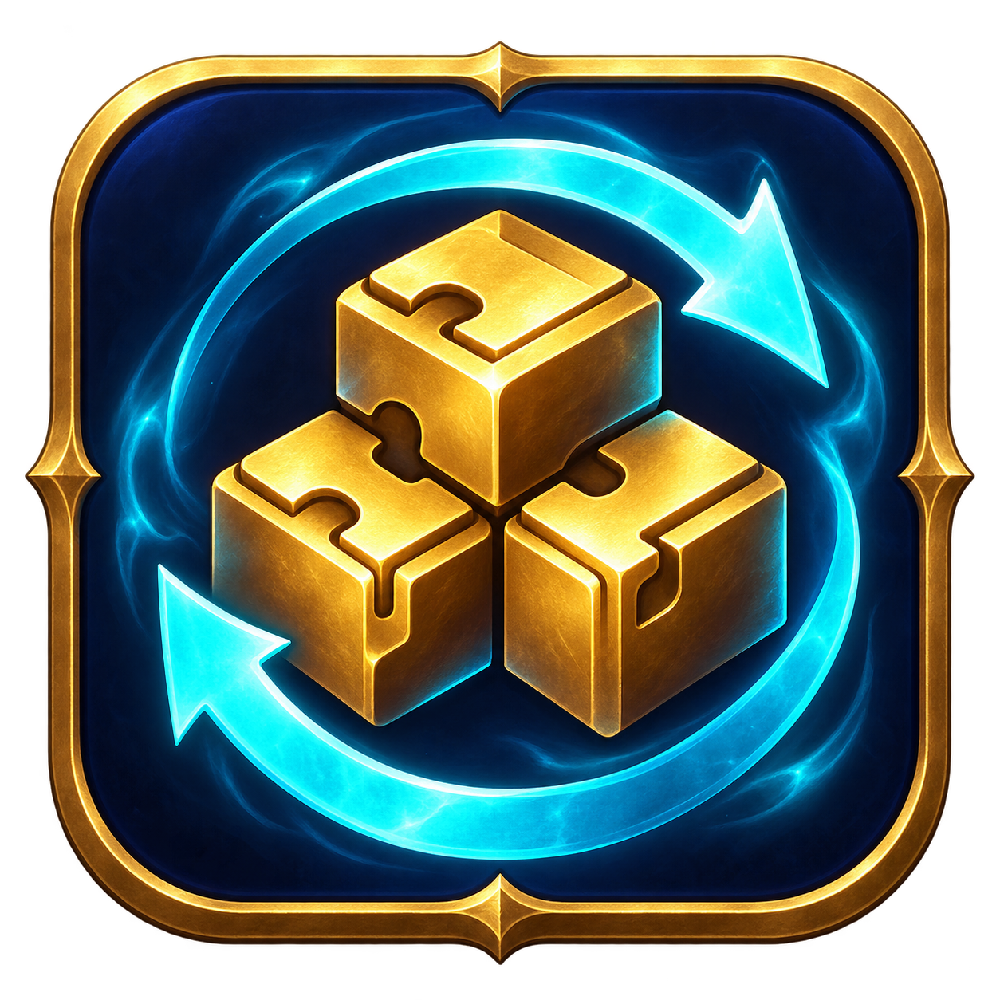
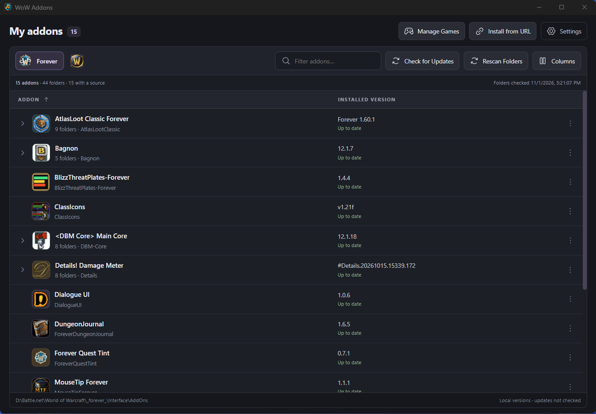

<p align="center"></p>

# WoW Addons

A compact, ad-free World of Warcraft addon manager built with **Rust and Tauri 2**. Keep separate libraries for Retail, Forever and Classic, install ZIPs, and manage CurseForge releases.

[Download](https://github.com/h2u/wow-addons/releases) · [Contribute](CONTRIBUTING.md) · [Buy Me a Coffee](https://buymeacoffee.com/edgars.spirins)



## Install

Windows x64 is tested end to end. The release workflow also builds a universal macOS DMG. From [Releases](https://github.com/h2u/wow-addons/releases), choose the appropriate file:

- `WoW-Addons-<version>-windows-x64-setup.exe`: installer, including WebView2 setup when needed.
- `WoW-Addons-<version>-windows-x64.exe`: portable app, requiring [Microsoft Edge WebView2 Runtime](https://developer.microsoft.com/microsoft-edge/webview2/) already installed.

On macOS, download the universal DMG for Apple Silicon and Intel. Mac builds are not yet Apple-notarized.

No Node.js or Rust installation is needed to run a release. Packages are currently unsigned. Until the first release is published, use the source build below.

Tauri uses the system WebView rather than bundling a browser engine. There is no Electron or Node.js runtime in the app. macOS receives a universal release build, with complete game-management testing still pending. Linux remains a source build: WoW has no official native Linux client. See [Blizzard support](https://us.support.blizzard.com/en/article/11571).

## Getting started

1. Open **Manage Games** and choose a WoW executable, client folder, `Interface/AddOns` folder, or the parent World of Warcraft folder.
2. Add one or more detected clients. Switch libraries with the client icon buttons.
3. Use **Rescan Folders** after changing addons outside the app. It scans TOCs, groups folders belonging to one package, resolves sources and obtains missing icons.
4. Configure your API key in **Settings** for CurseForge features.
5. Use **Install from URL**, **Check Updates**, or the addon's **⋯** menu.

The default table contains **Addon** and **Installed Version**. **Columns** enables and reorders extra fields. Clicking an addon opens its metadata, folders, icon and editable CurseForge link.

## CurseForge API key

Sign in or register at the [CurseForge developer console](https://console.curseforge.com/), then copy the API key available to your account. If the portal requests an application or approval, follow its current onboarding process. See the [official API access guide](https://support.curseforge.com/support/solutions/articles/9000208346-about-the-curseforge-api-and-how-to-apply-for-a-key).

Use **Settings → CurseForge API key → Save key**. **Clear key** removes it. No shared API key is bundled.

The key is saved in Windows Credential Manager, macOS Keychain or Linux Secret Service. If secure storage is unavailable, it stays in memory for the session. The Windows version can import the previous encrypted setting using native Windows APIs; on other platforms, enter the key again if migrating from the old preview.

Local scanning, ZIP imports and cached images work without a key. Online features use the [official CurseForge API](https://docs.curseforge.com/rest-api/). If downloading requires browser interaction or a CAPTCHA, open the provided download page in your browser and import its ZIP.

## Features

- Install the latest compatible stable release from a CurseForge project URL, or a specific release from its file URL.
- Drag one ZIP onto the app to install into the selected client. Existing folders require **Cancel / Reinstall** confirmation.
- Check updates per addon or for the whole library, then use **Update All**.
- **⋯ → Downgrade…** lists compatible Stable, Beta and Alpha releases. Load older pages on demand.
- Open the addon folder or CurseForge page, reinstall from ZIP, refresh an icon, or remove the package.
- Save a CurseForge project link in addon details; installed package manifests record all folders belonging to a ZIP.

**Up to date** means the release matches. **Latest: … · verify** means the latest release was found but local version labels cannot be compared reliably. Installing a known file records its ID for future checks.

Selecting an old release does not pin it: update checks can offer the latest stable again. Replacements and removals save backups; `WTF` character settings remain untouched. ZIP extraction rejects unsafe paths, checks client compatibility and stages replacements with rollback.

Automatic CurseForge release selection currently supports Retail, Forever and Classic Era. ZIP compatibility for progressing Classic clients also uses `.build.info`. Unknown client versions may need additional support.

## Application preferences

Settings includes **Keep running in the tray when closing the window** (on by default), **Launch at login** (off by default), and **Check addon updates when the app starts** (on by default). The tray icon appears while the app is running; use its menu to open the window or quit. Launching the app again opens the existing instance. If tray creation fails, closing the window quits normally.

Launch at login uses the OS login mechanism on Windows, macOS and Linux. Portable Windows executables also support it: keep the executable in a permanent location, and enable the option again after moving it. Disable launch at login before deleting a portable copy. Portable builds keep preferences in the same user data directory shown below. Linux requires a desktop environment with tray/AppIndicator support.

## Local data

| System  | Default directory                                       |
| ------- | ------------------------------------------------------- |
| Windows | `%APPDATA%/wow-addons`                                  |
| macOS   | `~/Library/Application Support/wow-addons`              |
| Linux   | `~/.config/wow-addons` or `$XDG_CONFIG_HOME/wow-addons` |

Profiles, inventory, links, package ownership and table preferences live in `inventory.json`. Icons and project metadata are in `cache/`, ZIP snapshots in `archives/`, and replaced/removed folders in `backups/`. WebView data is isolated in `webview/`. API keys live in the OS credential store.

Existing preview inventory and compatible icon caches are reused. Keep backups for manual recovery. Client switching uses saved snapshots without automatic rescans or API requests. At startup, addon update checks run for all saved profiles when enabled and a saved API key is available; they never install updates.

## Build from source

Install [Rust stable](https://rustup.rs/) and [Node.js 24 LTS](https://nodejs.org/) with npm. Node is used for development tooling only. Follow the [Tauri prerequisites](https://v2.tauri.app/start/prerequisites/) for your OS:

- **Windows:** Visual Studio Build Tools with Desktop development with C++, the MSVC Rust toolchain, and WebView2.
- **macOS:** Xcode command-line tools.
- **Linux:** a C compiler, GTK/WebKitGTK development packages and D-Bus development headers. Ubuntu/Debian setup is in [CONTRIBUTING.md](CONTRIBUTING.md).

Clone onto a local filesystem, then:

```sh
git clone https://github.com/h2u/wow-addons.git
cd wow-addons
npm ci
npm start
```

Build a release natively on the target OS:

```sh
npm run dist
```

The executable appears in `target/release/`; installer bundles appear in `target/release/bundle/`. Windows builds NSIS, macOS DMG, and Linux AppImage/DEB. Native toolchains must match the target architecture; these commands do not cross-compile macOS on Windows.

## Development and releases

See [CONTRIBUTING.md](CONTRIBUTING.md) for architecture, tests and PR guidelines. The UI is plain HTML/CSS/JavaScript; all filesystem, API, cache, credential and installation operations run in Rust.

GitHub Actions checks native compilation on Windows, macOS and Linux. Merged application PRs accumulate in one draft release, with the version determined by the highest major/minor/chore label since the previous stable release. To ship, open **Releases → draft → Publish release**. Publishing triggers Windows and macOS builds and attaches the installers to that release. There is no separate release PR. Assets appear after CI finishes; a failed build can be retried from Actions → CI → mode: retry with the published tag.

## License and credits

Project code is [MIT licensed](LICENSE). [Phosphor Icons](https://phosphoricons.com/) SVGs include their MIT license and source revision. The application logo was supplied for this project.

World of Warcraft and CurseForge belong to their respective owners. This independent project does not redistribute addon archives.

Formatting uses Prettier and rustfmt; linting uses ESLint and Clippy. See [the contributor checks](CONTRIBUTING.md#formatting-and-linting).

Application release builds check for updates at startup and in **Settings → About**. **Update and Restart** updates installed and portable Windows copies automatically; portable builds preserve the executable path. See [application updates](docs/application-updates.md) for signing, publishing, and recovery details.
